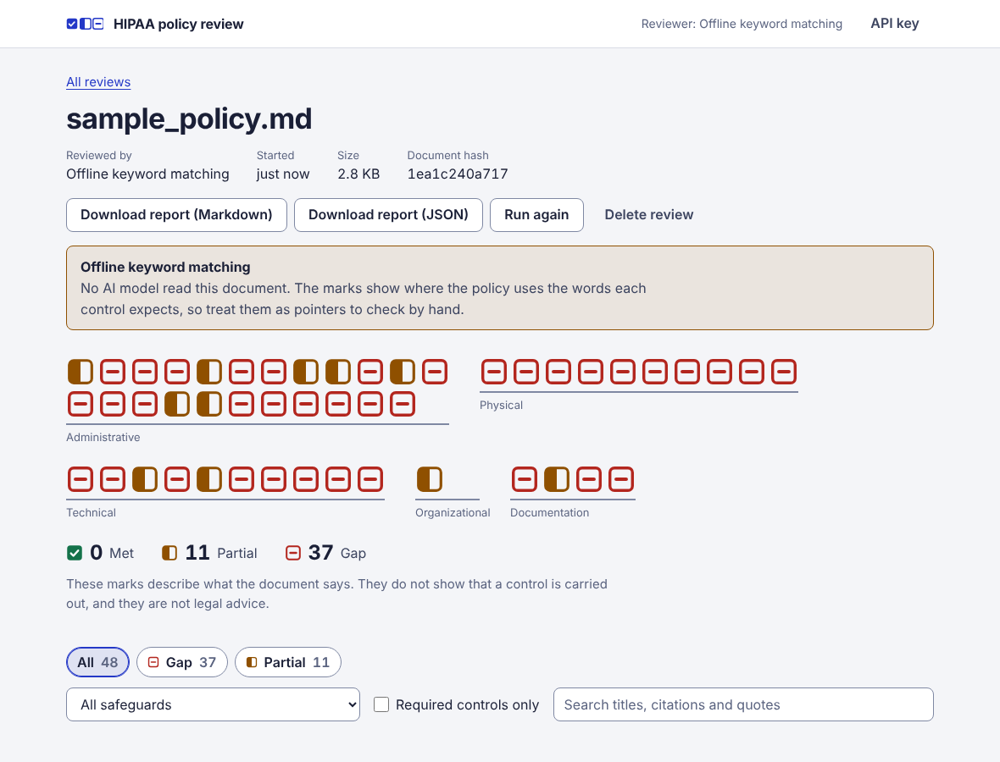
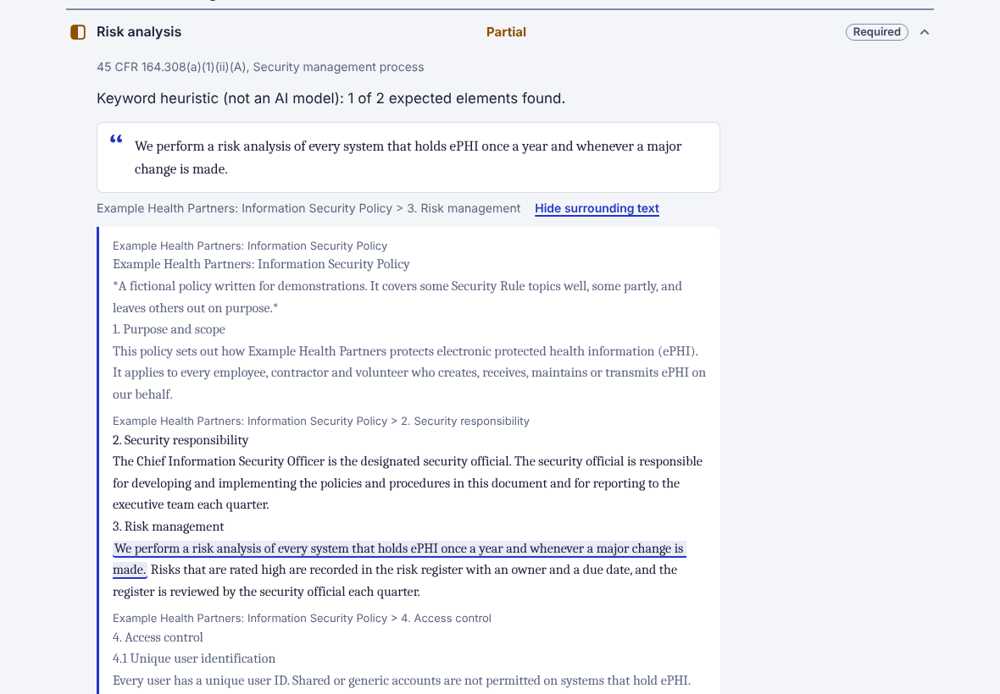
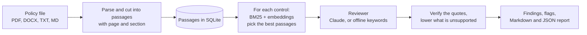

# HIPAA Security Audit Assistant

Upload an organisation's security policy (PDF, DOCX, Markdown or text) and get a control-by-control review against the HIPAA
Security Rule. For each of 48 controls you get **met**, **partial** or **gap**, a short rationale, the elements the policy does
not show, and quotes from the document that the server has checked are really there.

Python (Starlette) server, the Anthropic API for the assessments, a React interface. Version 0.1.0.

> This tool reviews what a policy document says. It is not legal advice and it does not certify HIPAA compliance: a policy that
> addresses a control does not show that the control is carried out or effective.



*A finished review of the bundled sample policy, run offline with the keyword locator. No AI model read it, and the interface
says so. With a Claude reviewer the page looks the same and the findings are judged, not matched on words.*

## What it does

- **Reads** PDF, DOCX, TXT and Markdown files (10 MB and 200 pages by default). Page, section and heading are kept with every
  passage, so a quote can be reported as "page 4, Access control". Scanned PDFs need OCR first.
- **Finds** the passages that bear on each control with BM25 and embeddings, fused by rank.
- **Assesses** each control against those passages by asking Claude for a structured answer, or with an offline keyword
  locator that needs no key.
- **Verifies** every quote against the document. A quote that is not there is dropped, and a status that rests on no verified
  quote is lowered to a gap and flagged for a person to look at.
- **Shows** the result in a browser interface (a strip of marks, counts, filters, each quote in its surrounding text) and
  downloads it as a Markdown or JSON report.
- **Counts, and does not score.** There is deliberately no compliance percentage ([why](docs/adr/0001-no-compliance-score.md)).



## What it does not do

- It does not look at systems, configurations, logs or evidence. It reads a document, so it cannot tell you a control is
  implemented, only whether the policy says so.
- It covers 48 controls, paraphrased for review support. They are not the regulatory text. Controls that apply only to health
  care clearinghouses and group health plans are left out. The catalog is written against the rule as it stood when it was
  prepared; a revision was proposed in December 2024, so check whether a final rule has been issued before relying on it.
- It does not read scanned PDFs (no OCR), password-protected files, or anything over the size and page limits.
- It does not detect or remove patient information before sending text to the model. **With the Claude reviewer, the text of
  the document is sent to the Anthropic API.** Read [docs/security.md](docs/security.md) before uploading anything.
- It is one process with a SQLite file, built for one team's use. There are no user accounts. See
  [docs/adr/0007](docs/adr/0007-sqlite-single-process.md) for how to outgrow that.

## Quick start

You need Python 3.11 or later. Building the interface needs Node (22 is what CI and the container use).

### Offline, with no key

The offline reviewer is a **keyword locator, not an AI model**. It is for trying the tool out, and it under-reports on purpose.

```sh
git clone https://github.com/rahul-phull3/hipaa-audit-assistant.git
cd hipaa-audit-assistant
python3 -m venv .venv && . .venv/bin/activate
pip install -e .

hipaa-audit audit examples/sample_policy.md --backend heuristic      # prints a Markdown report
```

To use the browser interface, build it once and start the server:

```sh
(cd ui && npm install && npm run build)
hipaa-audit serve --backend heuristic                                # http://127.0.0.1:8000
```

The editable install (`-e`) matters here: the server finds the built interface in `ui/dist` next to the source. For any other
layout, set `HIPAA_AUDIT_STATIC_DIR`.

### With Claude

```sh
cp .env.example .env            # then set ANTHROPIC_API_KEY in .env
hipaa-audit audit policy.pdf -o review.md
hipaa-audit serve
```

This sends passages of the document to the Anthropic API. Do not use it on documents that contain patient information unless
your organisation has approved that. A cheap first check of the whole path is two controls on one synthetic document:

```sh
hipaa-audit eval --backend anthropic --documents 1 --controls risk-analysis,data-backup-plan
```

### Docker

```sh
cp .env.example .env
docker compose up --build       # http://localhost:8000
```

The compose file publishes the port on the loopback address only, runs as an unprivileged user with a read-only root
filesystem, and keeps the database in a named volume.

`make` lists the everyday commands (install, lint, test, build the interface, the browser test, the offline demo).

## How a review works



1. **Parse and chunk.** The file is checked (type, size, pages, archive bombs), read, and cut into passages of about 200
   words that overlap a little, so a requirement that straddles a boundary can still be found.
2. **Retrieve.** Each control has several queries. BM25 and dense similarity each rank the passages for each query, and
   reciprocal rank fusion merges the rankings. The top six go to the reviewer. Dense similarity uses `fastembed` when it is
   installed and a built-in hashing embedder when it is not.
3. **Assess.** For one control at a time, Claude receives the control and the passages, with the passages marked as untrusted
   data, and answers by calling one strict tool: status, rationale, missing elements, quotes, confidence.
4. **Verify.** The server checks the answer. See below.
5. **Report.** Findings are stored as they arrive, so the interface fills in while a review runs. Reports are generated on
   request.

**What "verified" means.** Each quote must appear in the text the reviewer was shown, after tolerating differences in spacing,
case and typographic quotes. A quote that does not is dropped. A `met` or `partial` with no surviving quote becomes a `gap`, and
a `met` that still lists missing elements becomes `partial`. Each of these leaves a flag, and a finding with one of the flags
that matter is marked **needs review**. So the words you see quoted are in your document. That is all it means: a true quote
can still be misread, which is why a person should check the findings.

| Status | Meaning |
| --- | --- |
| **Met** | The document addresses every element the control expects |
| **Partial** | It addresses some of them. The missing ones are listed |
| **Gap** | It does not address the control, or mentions it only in passing. Quotes shown on a gap are the closest passages and do not count as support |
| **Not assessed** | The reviewer could not assess this control. Run the review again to retry it |

More in [docs/architecture.md](docs/architecture.md).

## Configuration

Settings come from environment variables or a `.env` file (`.env.example` explains each one).

| Variable | Default | |
| --- | --- | --- |
| `HIPAA_AUDIT_LLM_BACKEND` | `anthropic` | `anthropic`, or `heuristic` for the offline keyword locator |
| `ANTHROPIC_API_KEY` | | Required for the `anthropic` reviewer |
| `HIPAA_AUDIT_MODEL` | `claude-sonnet-5-5` | The model for assessments |
| `HIPAA_AUDIT_EFFORT` | `medium` | `low`, `medium`, `high`, `xhigh`, `max`, or `default` to let the API choose |
| `HIPAA_AUDIT_EMBEDDER` | `auto` | `auto`, `fastembed` or `hashing` |
| `HIPAA_AUDIT_TOP_K` | `6` | Passages sent to the reviewer for each control |
| `HIPAA_AUDIT_DB_PATH` | `./data/audits.sqlite3` | The SQLite file |
| `HIPAA_AUDIT_MAX_UPLOAD_MB` | `10` | Largest accepted upload |
| `HIPAA_AUDIT_MAX_PAGES` | `200` | Largest accepted PDF |
| `HIPAA_AUDIT_CONCURRENCY` | `4` | Controls assessed at once within one review |
| `HIPAA_AUDIT_MAX_ACTIVE_AUDITS` | `2` | Reviews running at once |
| `HIPAA_AUDIT_CACHE` | `true` | Reuse an answer when the passages, control and prompt are unchanged |
| `HIPAA_AUDIT_RETENTION_DAYS` | `0` | Delete reviews older than this when the server starts. 0 keeps them |
| `HIPAA_AUDIT_API_KEY` | | If set, every `/api` request except `/api/health` needs it in `X-API-Key` |
| `HIPAA_AUDIT_CORS_ORIGINS` | | Browser origins allowed to call the API. They may also change things |
| `HIPAA_AUDIT_ALLOWED_HOSTS` | | Host names to answer to. Loopback names only when started on a loopback address |
| `HIPAA_AUDIT_STATIC_DIR` | `ui/dist` | Where the built interface is |

The dense half of retrieval is better with the real embedding model: `pip install -e ".[embeddings]"`.

## Command line

| Command | |
| --- | --- |
| `hipaa-audit audit FILE` | Review a file and print the report (`--format md\|json`, `-o FILE`, `--controls a,b`, `--backend`, `--db FILE` to keep it, `-q`) |
| `hipaa-audit serve` | Start the server (`--host`, `--port`, `--db`, `--backend`, `--log-level`) |
| `hipaa-audit eval` | Score a reviewer on synthetic policies with known answers ([how to read it](docs/evaluation.md)) |
| `hipaa-audit controls` | List the 48 controls (`--json` for everything) |
| `hipaa-audit purge --days N` | Delete finished reviews older than N days |

Exit codes: 0 success, 1 the review failed, 2 bad input or configuration, 130 interrupted.

## HTTP API

The interface is a client of a small JSON API, so anything it does a script can do:

| | |
| --- | --- |
| `POST /api/audits` | Upload a file, start a review (`202`) |
| `GET /api/audits/{id}` | Progress and counts |
| `GET /api/audits/{id}/findings` | Findings so far |
| `GET /api/audits/{id}/report?format=md\|json` | The report |
| `POST /api/audits/{id}/cancel`, `/rerun` | Stop a review, or review the same stored text again |
| `DELETE /api/audits/{id}` | Delete a review and its stored text |

Every endpoint, the error format and a worked example are in [docs/api.md](docs/api.md).

## Security and privacy in brief

- The text of every reviewed document is stored in the database until the review is deleted or expires. The uploaded file is not.
- Set `HIPAA_AUDIT_API_KEY` and serve over TLS before exposing the server to anyone else. Browser requests that change
  something are refused unless they come from the server's own origin, and a server started on a loopback address answers only
  to loopback host names.
- Uploads are validated and bounded, parsers fail cleanly on damaged files, and the interface runs under a strict content
  security policy with no inline script or style.
- Documents can contain text that tries to instruct the model. The design limits what that can achieve; it cannot prevent it.

The details, and the list of what the tool does not do, are in [docs/security.md](docs/security.md).

## Evaluation

`hipaa-audit eval` generates synthetic policies whose answers are known by construction, runs a reviewer over them, and reports
per-status precision and recall, a confusion matrix, how often a gap was called met, and whether retrieval put the answer in
front of the reviewer. It is for comparing reviewers and catching regressions. **The numbers are not an accuracy estimate for
real policies**, because the documents are written from the catalog's own sentences. [docs/evaluation.md](docs/evaluation.md)
explains how to read it, why, and what a real evaluation would need.

## Repository layout

```
src/hipaa_audit/   the Python package: catalog, ingest, retrieval, assess, storage, service, report, evaluation, api, cli
ui/                the React interface, its unit tests and the browser test
tests/             Python tests
examples/          sample_policy.md, a fictional policy for demonstrations
docs/              architecture, security, api, evaluation, decision records (adr/)
Dockerfile, docker-compose.yml, Makefile, .env.example, .github/workflows/ci.yml
```

## Development

```sh
pip install -e ".[dev]"            # adds ruff and the HTTP test client the API tests need; the tests run with unittest
make install-ui                    # the interface's dependencies, once
make check                         # lint, Python tests, interface type-check and unit tests
make e2e                           # the browser test: builds the interface, starts a server, drives Chromium
```

The Python tests, the interface tests and the browser test all run offline and never call the Anthropic API. CI
(`.github/workflows/ci.yml`) runs lint and tests on Python 3.11 to 3.13, type-checks and builds the interface, runs the browser
test, and builds the container image.

To change a control, edit the YAML under `src/hipaa_audit/catalog/data/` and bump the catalog version. To change the prompt,
bump `PROMPT_VERSION` so cached answers are not reused. Both are explained in [docs/architecture.md](docs/architecture.md).

## Verification status

What has been run, and what has not. This is a first release, and the gaps below are the first things to close.

**Run and passing** (offline, on Linux, as of October 2026): the Python test suite, including tests that damage PDFs and DOCX
files and a run against a real `uvicorn` process; the interface unit tests; the browser test (15 scenarios in Chromium against
a real server with the offline reviewer); lint and formatting; the example in the API documentation, run against a real server.

**Not yet run:**

- **The Claude backend against the live API.** It has been tested only against a stand-in for the SDK. The request follows
  Anthropic's documentation for Claude Sonnet 5.5, but a first real run may need adjustments
  ([docs/adr/0006](docs/adr/0006-strict-tool-use.md)). Nothing has been measured about how well it assesses real policies.
- **Dense embeddings with `fastembed`.** The code path exists; it has not been run.
- **The container image and the CI workflow.** Both are written; neither has been run on a machine with Docker or on GitHub yet.
- **The interface's type-check against the real React type definitions.** It was checked against stand-ins, and CI runs the real
  check. There is no `package-lock.json` yet, so interface dependencies resolve when you install.
- **Installing the package into a clean environment** (`pip install .`). Development used an editable install.

## Documentation

- [Architecture](docs/architecture.md): the pieces, the life of a review, storage, the catalog, the interface
- [Security and privacy](docs/security.md): what is sent where, what is stored, hostile input, the HTTP surface, what is missing
- [HTTP API](docs/api.md): endpoints, errors, the report format, a worked example
- [Evaluation](docs/evaluation.md): the synthetic harness, how to read it, what its numbers do not mean
- [Decision records](docs/adr/README.md): why it is built the way it is

## Licence

MIT. See [LICENSE](LICENSE).
