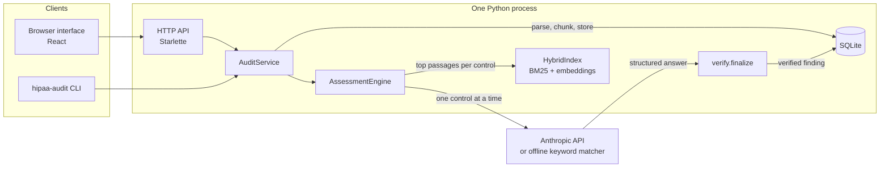
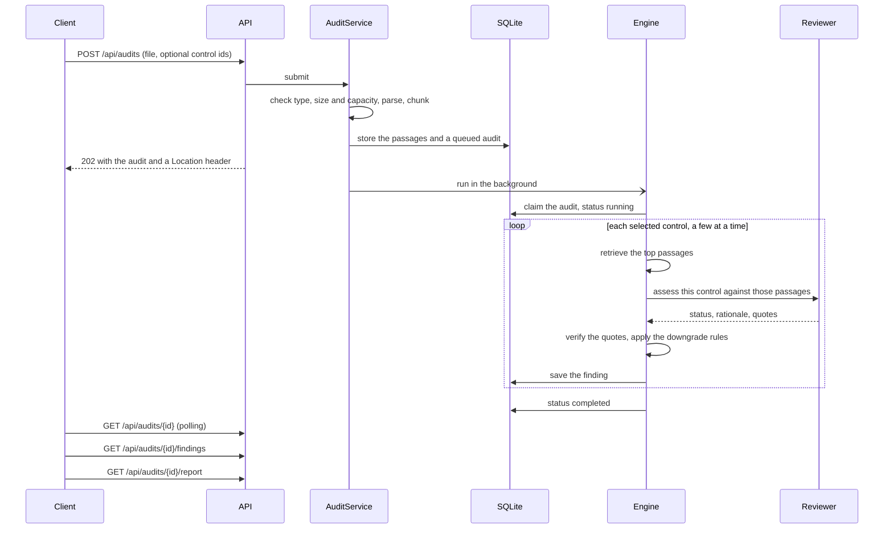

# Architecture

This page explains how the pieces fit together and why they are shaped the way they are. The security properties are in
[security.md](security.md), the HTTP interface in [api.md](api.md), and the reasoning behind the main decisions in
[adr/](adr/).

## The shape of the system

Everything the API and the command line do goes through `AuditService`. It has no web framework in it, so the CLI runs a
review without starting a server and the tests drive it directly.

| Package | What it does |
| --- | --- |
| `config.py` | Settings from environment variables and an optional `.env` file |
| `catalog/` | The 48 controls as YAML, with a typed loader and validation |
| `ingest/` | `parsers.py` turns a PDF, DOCX, TXT or Markdown file into ordered blocks; `chunking.py` cuts them into passages |
| `retrieval/` | Tokenizer, BM25, embedders and the hybrid index that fuses them |
| `assess/` | The prompt, the strict tool schema, the two backends, quote verification, the injection warning and the engine that runs a control at a time |
| `storage.py` | The SQLite repository and the answer cache |
| `service.py` | The application service: submit, run, cancel, rerun, read, delete, report |
| `report.py` | The report as a structure (served as JSON) and its Markdown rendering |
| `evaluation/` | Synthetic policies with known answers, scoring and a runner |
| `api/` | The Starlette application and its middleware |
| `cli.py` | `audit`, `serve`, `eval`, `controls` and `purge` |
| `ui/` | The React interface (a separate build, served by the same process) |

## The life of a review

Uploading is synchronous and cheap: validate, parse, chunk, store, answer `202 Accepted`. The slow part runs as a background
task, so a request never waits on a model. A client polls the audit for progress and reads findings as they arrive, which is
how the interface fills in its strip while a review runs.

An audit is `queued`, then `running`, then one of `completed`, `failed` or `cancelled`.

- **Concurrency is bounded twice.** `HIPAA_AUDIT_MAX_ACTIVE_AUDITS` (default 2) limits how many reviews run at once and
  `HIPAA_AUDIT_CONCURRENCY` (default 4) limits how many controls one review assesses at once. Uploads are refused with
  `429` once 20 reviews are waiting or running.
- **One control failing does not fail the review.** An unexpected error or an unusable model answer becomes an `error` finding
  for that control ("Not assessed") and the rest carry on. A rejected API key stops the run, since every later call would fail
  the same way. If no control could be assessed the review is `failed`.
- **Cancelling** stops new controls from starting and lets the ones in flight finish. A queued review is cancelled at once.
- **Restarts.** A review that was waiting or running when the server stopped is marked `failed` at the next start. Nothing is
  resumed silently.
- **Run again** creates a new review over the stored passages, with no new upload. Controls whose answers are cached cost no
  model call the second time.

## Reading the document

`ingest/parsers.py` treats the upload as untrusted input.

- The type is checked by extension and by magic bytes. Text files that look binary are refused.
- PDFs are read with `pypdf`. A PDF that needs a password is refused (one locked only against editing is opened with the empty
  password). There is no OCR step: a document with fewer than 20 words of body text, which is what a scanned PDF gives, is
  refused with a message that it needs OCR first. A page limit applies (default 200).
- DOCX files are checked as archives before they are opened: the total unpacked size (100 MB) and the number of members
  (5,000) are capped to stop decompression bombs. Tables are read row by row.
- Headings are detected from Markdown markers, DOCX heading styles and, for plain text and PDF, a few conservative line
  heuristics. The heading path (for example `Access control > Password management`) travels with every passage.

`ingest/chunking.py` cuts the blocks into passages of about 200 words, in reading order:

- A passage holds whole paragraphs; a long paragraph is split on sentence boundaries.
- When a passage closes because it is full, the next one starts with the last sentences of the previous one (up to 40 words),
  so a requirement that straddles a boundary can still be retrieved.
- A new heading closes the open passage once it has at least 40 words. A shorter section is merged into the next passage.
- Each passage records the page and section of every paragraph it holds (`spans`), so a quote is reported with the place it
  really came from even when a passage runs across sections.

## Finding the passages for a control

`retrieval/hybrid.py` combines two rankings for each query, and every control carries several queries (two or more, written
in the catalog).

1. **BM25** over the passages, with a small tokenizer that lower-cases, drops stop words and folds common suffixes.
2. **Dense similarity** between the query and each passage.

The rankings (top 20 of each, per query) are fused with reciprocal rank fusion, `sum(1 / (60 + rank))`, and the best six
passages overall go to the reviewer, in document order. RRF needs no score calibration between the two rankers, which is
why it was chosen over a weighted sum (see [adr/0003](adr/0003-hybrid-retrieval.md)).

The dense half uses `BAAI/bge-small-en-v1.5` through the optional `fastembed` package (CPU, ONNX, no API call). Without it a
built-in hashing embedder is used: signed hashed word and character n-gram features. That captures plurals, typos and shared
word pieces, not meaning, so retrieval is noticeably better with the real model installed. The embedder that was used is
recorded on every review and printed in the report.

## Asking the model

`assess/llm.py` has two backends behind one small protocol, `assess(control, excerpts) -> (raw assessment, usage)`.

**`AnthropicBackend`** sends one request per control.

- The system prompt holds the rules (excerpts are untrusted data, judge only what they say, quote exactly, a silent policy is
  a gap) and is marked for prompt caching.
- The user message carries the control, what it expects, the elements to look for, and the passages inside XML-style tags.
  Passage text is XML-escaped, so a document cannot close the tags itself.
- The answer must come back as a call to one tool, `record_assessment`, declared `strict` so the API validates it against
  the schema. The request uses `tool_choice: auto`, because forcing a tool is rejected by the model this was written for
  (see [adr/0006](adr/0006-strict-tool-use.md)), and sends no sampling parameters for the same reason. Reasoning effort is set
  with `HIPAA_AUDIT_EFFORT`.
- A malformed or truncated answer gets one more attempt with a doubled token budget. Transport failures (rate limits, 5xx,
  dropped connections) are retried by the SDK client. An unreachable service becomes an `error` finding for that control.

**`HeuristicBackend`** is the offline backend. It finds, for each element a control expects, the paragraph that shares the
most keywords, and reports a status from how many elements it found. **It is a keyword locator, not an AI model**, and
everywhere its output is shown it is labelled that way (see [adr/0005](adr/0005-heuristic-backend.md)). It exists so the tool
can be tried with no key, so CI can exercise the whole stack, and so the evaluation harness has a free baseline.

## Checking the answer

Both backends return a raw assessment. `assess/verify.py` then decides what is kept, the same way for either.

1. Each quote must appear in the passage text the reviewer was shown, after normalising Unicode, curly quotes and dashes,
   whitespace and case. A quote may use `...` to skip words; each part must then appear in order. Quotes shorter than 12
   characters are dropped as unverifiable.
2. A quote attributed to the wrong passage is re-attached to the passage that really contains it (`evidence_id_corrected`).
   A quote that is in none of them is dropped (`quote_not_found`).
3. A `met` or `partial` with no surviving quote becomes a `gap`, its confidence is capped at 0.4, and it is flagged
   `unsupported_downgraded`.
4. A `met` that still lists missing elements becomes `partial` (`met_with_missing_downgraded`).

So every quote a person sees is real text from their document, and no status rests on support that cannot be found. This
does not make the reading of that text correct, which is why findings with these flags are marked "needs review" and why the
report says a person should check them. See [adr/0002](adr/0002-verify-quotes.md).

`assess/injection.py` scans each passage for text that reads like an instruction to an AI system. A match only adds the
`injection_suspected` flag so a reviewer looks at it. It is a warning, not a defence: the defences are the escaping, the
prompt, the strict tool and the quote check above.

## Storing it

`storage.py` is a small repository over SQLite (write-ahead logging, foreign keys on, the schema versioned with
`PRAGMA user_version`; a database written by a newer release is refused rather than guessed at).

| Table | Holds |
| --- | --- |
| `audits` | The review: file name, SHA-256, size, pages, status, backend, embedder, catalog and prompt versions, selected controls, progress, token usage, error |
| `chunks` | The passages of the document, with page, section and the paragraph spans |
| `findings` | One row per assessed control, as JSON, in catalog order |
| `assessment_cache` | Raw answers keyed by prompt version, backend, control definition and the exact passage text |

**The uploaded file itself is never stored**, only its hash and the text passages extracted from it, because the interface
needs the text to show a quote in context and "run again" needs it to repeat a review. The passages are the policy text, so the
database is sensitive; see [security.md](security.md). Deleting a review removes its passages, findings and cached answers
(`ON DELETE CASCADE`).

A single process with SQLite is a deliberate scope choice (see [adr/0007](adr/0007-sqlite-single-process.md)).

## The control catalog

`catalog/data/*.yaml` holds 48 controls: 23 administrative, 10 physical, 10 technical, 4 on policies and documentation and 1
organizational. Each one is a paraphrase written for review support, not the regulatory text, and carries:

- an id, the citation, the standard it belongs to and whether it is **required** or **addressable**;
- an `expectation`, the sentence the reviewer is asked to judge the policy against;
- `criteria`, the elements a policy should show, each with the keywords the offline matcher looks for and an example
  sentence used by the synthetic-policy generator;
- `queries`, the retrieval queries for the control.

The catalog has a version (`2026.10-r1`) that is stored on every review, so a finding says which edition it was assessed
against. Controls that apply only to particular entity types (health care clearinghouses and group health plans) are not
included, and the catalog says so. The text of `meta.yaml` records that a revision of the rule was proposed in December 2024
and that a final rule should be checked for before relying on the catalog.

To change a control, edit the YAML and bump the catalog version. The cache key includes the control's full definition, so a
changed control is never answered from a stale cache entry. Change `PROMPT_VERSION` in `assess/prompts.py` whenever the prompt
wording changes, for the same reason.

## The HTTP layer

`api/app.py` is a Starlette application with plain functions for handlers and `AuditService` behind them. Errors raised by the
service map to one JSON shape and a fixed set of statuses. The middleware is written directly against ASGI, in this order,
outermost first:

1. security headers (every response; a strict content security policy on pages, `no-store` on `/api`);
2. CORS, only if origins are configured;
3. an error boundary, so an unexpected exception becomes a generic `500` that still carries the security headers;
4. the API key check, if a key is configured (`/api/health` stays public for health probes);
5. the request body limit, applied from `Content-Length` and again while the body streams.

The same process serves the built interface from `HIPAA_AUDIT_STATIC_DIR`, or from `ui/dist` in a source checkout, so there is
one origin and no CORS to configure.

## The interface

`ui/` is React 19 with TypeScript, bundled by esbuild alone: there is no framework, router or component library, and no
runtime dependency beyond React. It is written to run under the strict content security policy (no inline scripts or styles,
no external fonts or images).

- The home page uploads a document and lists earlier reviews. A review is `#/audits/<id>`; routing is by hash so the static
  server needs no rewrite rules.
- A review shows a **strip**, one mark per control grouped by safeguard, above the counts and a filterable list. A mark's
  shape, not only its colour, says met, partial, gap, not assessed or waiting.
- There is **no overall score**, deliberately (see [adr/0001](adr/0001-no-compliance-score.md)). The counts say what the
  document says; they do not claim a conclusion the tool cannot reach.
- Quoted text is set in a serif face to separate the document's words from the tool's; "Show surrounding text" opens the
  quote inside its neighbouring passages with the quote highlighted.
- When the offline matcher produced the review, a notice says no AI model read the document.
- The browser test covers keyboard use and focus handling, a phone layout and the dark colour scheme. Reduced motion is
  honoured in the stylesheet and in the one animation, the strip's reveal when a review opens; the tests do not cover it.

## Tests

| Where | What it covers |
| --- | --- |
| `tests/` (Python, `unittest`) | Catalog validation, parsing and chunking, retrieval, quote verification and downgrade rules, both backends (the Anthropic one against a stub client), the engine's failure handling, storage, the service, the API, the CLI, the evaluation harness, and a run against a real `uvicorn` process |
| `ui/test/` | Formatting, API client behaviour, finding filters and grouping, colour contrast of the palette, and a hygiene check against inline styles and scripts |
| `ui/e2e/run.mjs` | Fifteen scenarios in a real browser against a real server: upload, the strip, filters, quotes in context, downloads, delete, dark mode, a phone, every state a review can be in, and an API key prompt |

None of these call the Anthropic API. The Anthropic backend is tested against a stand-in for the SDK, so its first real use
is the first time the request shape meets the live service; see [the verification notes](../README.md#verification-status).
